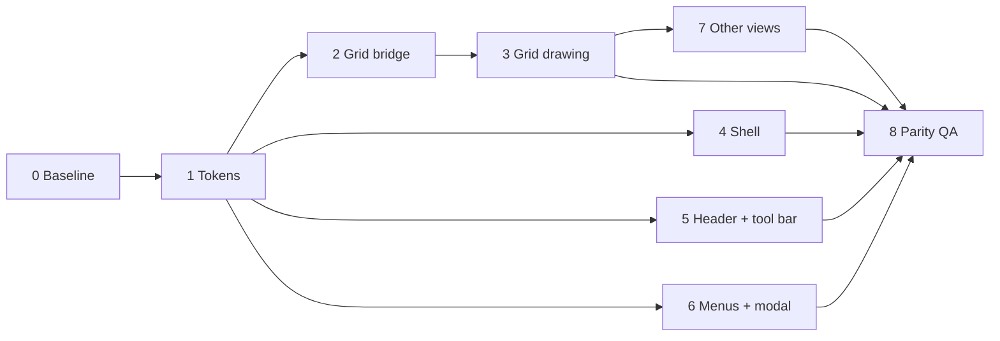

# Frontend Redesign — Implementation Plan (rev. 2: UI only)

Companion to `current-design.md` (the *what* and *why*; §-numbers and D-numbers point there).
This file is the *order*, the *files*, and the *proof* for each step.

Branch: `feat/updated-design` (cut from `feat/updated-graphy` at `d9cb232`) · Base: `feat-db-setup`
Demo to match: https://claude.ai/artifact/8hD9igtVKiPGXAgj8HGnHS

> The previous content of this file (Base Graph plan) is in git history:
> `git show HEAD:scripts/customized/developments/current-implementation-plan.md`.

Legend: `[ ]` todo · `[~]` in progress · `[x]` done · **GATE** = stop until cleared.
Size: S ≈ under a day, M ≈ 1–3 days, L ≈ 3–5 days.

**Rule for every phase (design §0):** only styling and draw code change. No new or removed
controls, no changed handlers, props that carry behaviour, menu items, labels, routes, API calls
or i18n keys. Each phase ends with a **parity gate** that walks the matching part of design §3.
A diff that touches an `on*` handler, a `RegionType`, a menu item list or a `useHotkeys` call
needs a written reason in the PR, or it is reverted.

## Status — 2026-10-22: planned, nothing started

| Phase | Size | Depends on | State |
|---|---|---|---|
| 0 Baseline | S | — | [ ] |
| 1 Token foundation | M | 0 | [ ] |
| 2 Grid theme bridge | M | 1 | [ ] |
| 3 Grid drawing | L | 2 | [ ] |
| 4 Shell and sidebar | S | 1 | [ ] |
| 5 Table header, view tabs, tool bar | M | 1 | [ ] |
| 6 Menus, popovers, dialogs, record modal | M | 1 | [ ] |
| 7 Other views and pages | L | 1–3 | [ ] |
| 8 Parity QA and cleanup | M | all | [ ] |



Phases 2–3, 4, 5 and 6 can run in parallel once Phase 1 is merged.

## Step tracker

One line per step; a step is `[x]` only with evidence (commit, test output) in the Evidence column.
Phase details, files and proof are in the phase sections below.

| # | Phase | Step | State | Evidence |
|---|---|---|---|---|
| 01 | P0 | Work on branch `feat/updated-design` | [x] | branch exists at `d9cb232`, 2026-10-22 |
| 02 | P0 | Write the parity suite (design §3) | [~] | `apps/nextjs-app/e2e/parity/`: grid page done, 11 tests / 17 recorded checks, green 3× in compare mode on `d9cb232` (2026-10-22). Sidebar, header tabs, kanban and modal checks are added in the phase that touches each area |
| 03 | P0 | Capture before-screenshots | [x] | `redesign-baseline/before-*` (git-ignored locally): data-centre grids + space, light and dark; fixture grid, grouped grid, kanban, field menu, record menu, filter, record modal, space, light and dark (`E2E_SHOTS=before`) |
| 04 | P0 | Record the grid FPS baseline | [x] | `fps.parity.ts`, 10k rows, 10 s scroll: run 1 p50 16.7 ms / p95 16.8 ms, run 2 p50 16.7 ms / p95 33.4 ms (≈55 fps), headless Chrome |
| 05 | P1 | Replace tokens in `global.shadcn.css`, delete amber | [x] | Twenty light under `:root`, dark under `.dark`, amber blocks deleted; body font Inter Variable; `themeColor` dark `#171717`. Parity 11/11 after the change |
| 06 | P1 | Expose the new tokens in Tailwind; font sizes | [x] | `packages/ui-lib/tailwind.config.cjs`: `background-secondary`, `foreground-tertiary`, `foreground-light`, `border-light`, `selection`, `hue.*`, `shadow-1/2`, `text-2xs/xs/sm` = 11/12/13px. (`themes/tailwind/tailwind.theme.js` is not loaded by any config, so it was left alone) |
| 07 | P1 | Add the contrast-check script | [x] | `check-contrast.mjs`: 20/20 pairs pass (light text 12.6:1, muted 5.7:1, dark text 15.1:1) |
| 08 | P1 | Sweep "dark under light" classes | [x] | grep for literal hex / black-white classes: only image overlays, brand logos and `dark:`-only overrides remain; the fork's dark commit `dfe47e2` touched 4 files, so upstream light/dark classes are intact. Toolbar active fills move in step 20 |
| 09 | P2 | Add colour and tag-style utils with specs | [x] | `grid/utils/color.ts`, `tag-style.ts`; 13/13 specs pass (`vitest run src/components/grid/utils`) |
| 10 | P2 | Rewrite `useGridTheme` from CSS variables | [x] | `buildGridTheme` + MutationObserver on the root class; `gridTheme.ts` defaults are light hex; 5 new specs, grid specs 37/37; sdk typecheck clean apart from 3 pre-existing spec errors (`record.spec.ts`, openapi stream specs); screenshots `p2-*` |
| 11 | P2 | Key the sprite cache on `themeKey` | [x] | no change needed: `SpriteManager` keys on `${bgColor}_${fgColor}_${size}_${sprite}`, so new theme colours make new sprites (verified visually in `p2-*` dark/light) |
| 12 | P3 | Grid geometry and row head | [x] | `columnStatisticHeight` 40→32; row-head checkbox 14px / radius 3 in the same 16px slot. **Deviation:** `groupHeaderHeight` stays 48 (a one-line 36px header would clip the group value in narrow first columns). Coordinate spec 15/15, parity 11/11 |
| 13 | P3 | Header and frozen divider | [x] | menu triangle → 12px chevron in the same `columnHeadMenuSize` box; lock/description sprites unchanged; header text keeps its weight (the text drawer has no weight option, so measuring is unchanged). Divider already 1px + shadow on scroll; recoloured by tokens |
| 14 | P3 | Tags, chips, checkbox, numbers | [x] | `displayChoiceMap` carries `colorName`; select renderer draws `getTagStyle` (outline / soft / strong) with radius 4, padding kept at 8 so the tag × region is unchanged. Checkbox cell 16px box in the unchanged 20px target. Relation chips already neutral via `cellOptionBg`. Row counter and draft-row accents on tokens |
| 15 | P3 | Group, append and statistic rows | [x] | group rows recoloured by tokens and tag styles via the shared choice map; statistic row 32px; append row unchanged geometry. Filter/sort/group column tints left as upstream light/dark values |
| 16 | P3 | Primary-cell avatar | [x] | `ITextCell.avatar` (set for primary single-line text); 14px hashed-hue square + initial, text shifted 20px, measure uses the same width. No new region. Known: the text editor opens at the old 8px inset (text moves 20px left while editing) |
| 17 | P3 | Active cell, selection, editors | [x] | no canvas change needed: active cell already 1px `cellLineColorActived` radius 2, selection uses `--selection`; editor popups follow the ui-lib restyle (step 21) |
| 18 | P4 | Shell and sidebar | [x] | sidebar on `bg-background-secondary`, no divider line; base content wrapped in one `rounded-lg border` card on the page ground (`BaseLayout`). Other layouts (space, settings, share) still flush — see 25 |
| 19 | P5 | Table header and view tabs | [x] | view tabs: muted text, active view underlined instead of filled (classes only; DnD, menus, rename unchanged) |
| 20 | P5 | Tool bar and active fills | [x] | filter / sort / group active fills → `bg-hue-{purple,orange,green}/15` in grid, kanban, calendar, gallery bars (fixes the unreadable dark "Group by" button) |
| 21 | P6 | ui-lib menus, popovers, dialogs | [x] | popover, hover-card, context-menu, dropdown, select: `rounded-lg border-border shadow-2`; separators `bg-border`; dialog `shadow-2`. ui-lib lint 0 errors |
| 22 | P6 | Record modal and add-record modal | [x] | DOM tags (`getTagCss`, `color-mix` on theme vars) in `CellSelect`/`SelectTag`, grid select editor and filter tags; modal itself already two-column, restyled by tokens |
| 23 | P7 | Kanban | [x] | stack headers and card tags use the DOM tag styles; cards follow tokens (`p5-*`) |
| 24 | P7 | Gallery, calendar, form, list | [~] | tokens + tool bar fills only; calendar events get CSS tag colours via `getColorPairs`. No view-specific screenshots yet |
| 25 | P7 | Space, settings, admin, share pages | [~] | tokens only; the bordered-card shell is not yet applied to Space/Setting/Share layouts |
| 26 | P8 | Full parity suite and manual §3 walk | [ ] | |
| 27 | P8 | Colour sweep, accessibility, FPS | [~] | amber grep empty (outside a negative spec); FPS after: p50 16.7 / p95 16.8 ms ×2 = baseline. axe run not done |
| 28 | P8 | Diff audit for behaviour changes | [x] | `git diff -U0` on ts/tsx: no added `on*=` handlers, `useHotkeys`, `RegionType`, or menu items. Behavioural surface unchanged; parity 11/11 ×2 at the end |
| 29 | P8 | Architecture doc and status update | [ ] | |

Commands used for proof throughout:

```bash
pnpm -F @cybernetics/sdk typecheck && pnpm -F @cybernetics/sdk lint && pnpm -F @cybernetics/sdk test-unit
pnpm -F @teable/app typecheck && pnpm -F @teable/app lint && pnpm -F @teable/app test-unit
pnpm -F @teable/ui-lib typecheck && pnpm -F @teable/ui-lib lint
```

---

## Phase 0 — Baseline (S)

- [ ] 0.1 Cut `feat-twenty-ui` from `feat-db-setup`.
- [ ] 0.2 **Behaviour baseline.** Write a Playwright parity suite in
  `apps/nextjs-app/e2e/parity/` (existing `playwright.config.ts`) that drives every row of design §3
  against `data-centre › tasks` and asserts the outcome (menu item lists and order, which dialog
  opens, record count after insert / delete, sort order, filter results, undo / redo, keyboard
  edits). It runs green on the **unchanged** app first. This suite is the contract.
  Use system Chrome at `/usr/bin/google-chrome`, because Playwright's bundled browsers are not installed.
- [ ] 0.3 Before-screenshots of space home, grid (flat, grouped by `progress`), record modal,
  kanban and settings.
- [ ] 0.4 Grid FPS baseline: 10k rows, scroll for 10s with `performance-tracker`, p50 / p95.
- [x] 0.5 **GATE** cleared 2026-10-22 (design §10): the amber palette is removed, and primary-cell avatars are kept.

Proof: the parity suite is green on the base branch; screenshots and FPS numbers are recorded here.

---

## Phase 1 — Token foundation (M)

Files:
- `packages/ui-lib/src/shadcn/global.shadcn.css`: delete both "Exocortex amber" blocks; `:root` =
  Twenty light, `.dark` = Twenty dark (design §5); new tokens `--background-secondary`, `--foreground-tertiary`, `--foreground-light`,
  `--border-light`, `--selection`, `--shadow-1`, `--shadow-2`, `--hue-*`; `--radius: 0.5rem`.
- `packages/ui-lib/tailwind.shadcnui.config.cjs`: expose the new colors and shadows.
- `apps/nextjs-app/src/themes/tailwind/tailwind.theme.js`: font sizes 11 / 12 / 13.
- `apps/nextjs-app/src/styles/global.css`: FullCalendar overrides on tokens.
- `apps/nextjs-app/src/AppProviders.tsx`: only `themeColor` (`#ffffff` / `#171717`). The provider
  config stays the same otherwise.

Steps:
- [ ] 1.1 Write the tokens.
- [ ] 1.2 Add `scripts/customized/developments/check-contrast.mjs`: it asserts ≥ 4.5:1 for foreground and
  muted-foreground on background in both blocks, and ≥ 3:1 for primary.
- [ ] 1.3 Find classes that assumed "dark under light" (`text-white`, `bg-black`, literal
  `dark:bg-[#…]`) and move them to tokens. Class names only; no markup or logic changes.

Proof: the contrast script passes; three typechecks and lints are clean; the parity suite is green;
after-screenshots in light and dark.

---

## Phase 2 — Grid theme bridge (M)

Files:
- `packages/sdk/src/components/grid/utils/color.ts` *(new)*: `parseHsl`, `toRgb`, `mixColor`,
  `withAlpha`.
- `packages/sdk/src/components/grid/utils/tag-style.ts` *(new)*: `getTagStyle(color, palette)` per
  D4.
- `packages/sdk/src/components/grid-enhancements/hooks/use-grid-theme.ts`: build `IGridTheme`
  from CSS variables on theme change; SSR fallback = light defaults.
- `packages/sdk/src/components/grid/configs/gridTheme.ts`: light defaults; all amber / cyan hex
  removed. `IGridTheme` gains `tagPalette`, `selectionBg`, `columnHeaderIconColor`,
  `shadowColor`. These are drawing inputs only.
- `packages/sdk/src/components/grid/managers/sprite-manager/SpriteManager.ts`: key the sprite cache
  on `themeKey` so that icons recolor when the theme switches.

Key mapping: `cellBg`→`--background`, `cellBgHovered`→`--background-secondary`,
`cellBgSelected`→`--selection`, `cellLineColor`→`--border-light`, `cellLineColorActived`→`--primary`,
`cellTextColor`→`--foreground`, `columnHeaderBg`→`--background`, `columnHeaderBgHovered`→`--accent`,
`columnHeaderBgSelected`→`--selection`, `columnHeaderNameColor`, `iconFgCommon` and
`rowHeaderTextColor`→`--foreground-tertiary`, `iconBgSelected`→`--primary`,
`groupHeaderBg*`→`--background-secondary` / `--accent`, `columnStatisticBgHovered*`→`--accent`,
`scrollBarBg` and `interactionLineColorCommon`→`--border-high`,
`interactionLineColorHighlight` and `columnResizeHandlerBg`→`--primary`,
`columnDraggingPlaceholderBg`→primary 10%, `commentCountBg`→`--destructive`,
`searchCursorBg` / `searchTargetIndexBg`→yellow hue 35% / 18%.

Steps:
- [ ] 2.1 `color.ts` + spec.
- [ ] 2.2 `tag-style.ts` + spec: all 50 `Colors` map; the D4 table; the user's pairs
  (`redDark1`/`redBright`, `greenLight1`/`green`) stay distinct.
- [ ] 2.3 Rewrite `useGridTheme`; delete the duplicated dark object.
- [ ] 2.4 Switch the theme at runtime and confirm a full repaint with no stale sprites.

Proof: specs pass; `grep -rn "FFB547\|4DE8FF\|0E0C08" packages apps --include=*.ts*` is empty;
the parity suite is green.

---

## Phase 3 — Grid drawing (L)

Only `draw*` functions and cell renderers' `draw` paths change. `checkRegion`, `onClick`,
`RegionType`, `coordinate-manager` and `InteractionLayer` handlers are **not edited**.

Files (under `packages/sdk/src/components/grid/`):
- `configs/grid.ts`: design §7 (statistic 32, group header 36). Nothing else.
- `renderers/layout-renderer/layoutRenderer.ts`:
  - `drawRowHeader`: same three controls in the same slots; new colors, 14px checkbox, radius 3.
  - `drawColumnHeader`: tertiary icon / name (500); the triangle becomes a 12px chevron drawn in the
    same `columnHeadMenuSize` box; lock and description sprites stay where they are.
  - `drawCells` / `drawActiveCell` / `drawFillHandler`: new fills, 1px active border.
  - `drawGroupRow` / `drawGroupRowHeader`: 36px, chevron, tag via `getTagStyle`, count.
  - `drawAppendRow` / `drawAppendColumn`: centred "+" in tertiary; same widths.
  - `drawColumnStatistics` / `drawStatisticCell`: 32px, tertiary label + 500 value; the "Summary"
    hover text and its trigger stay the same.
  - `drawFreezeRegionDivider`: 1px border + soft shadow while scrolled; handler box unchanged.
- `renderers/cell-renderer/selectCellRenderer.ts`: D4 colors, radius 4, padding 6. Re-run its
  hit-test spec cases for the delete "×" on multi-select tags.
- `renderers/cell-renderer/linkCellRenderer.ts`, `userCellRenderer.ts`: chip fill and avatar.
- `renderers/cell-renderer/textCellRenderer.ts`: avatar before the primary text (drawing only;
  the text start offset moves, so the editor's text alignment is checked in 3.5).
- `renderers/cell-renderer/booleanCellRenderer.ts`: 14px box, `--primary` fill.
- `components/editor/EditorContainer.tsx`: border / radius / shadow classes only.

Steps:
- [ ] 3.1 Geometry (§7) + row head colors.
- [ ] 3.2 Header + frozen divider.
- [ ] 3.3 Tags, chips, checkbox, numbers.
- [ ] 3.4 Group rows, append row / column, statistic row.
- [ ] 3.5 Primary avatar (kept, design §10.2): drawn only, no new region; check that the editor text lines up with the text after the avatar.
- [ ] 3.6 Active cell, selection, fill handle, editors.

Proof: unit tests green including `Coordinate-manager.spec.ts`; the parity suite's grid section is green
(column select, header menu, double-click settings, drag, resize, freeze, fill, range, context
menus, statistics, group collapse, append row / column); Playwright screenshots match the demo;
FPS within 10% of the baseline at p95.

---

## Phase 4 — Shell and sidebar (S)

Files: `layouts/BaseLayout.tsx`, `SpaceLayout.tsx`, `SpaceInnerLayout.tsx`, `SettingLayout.tsx`
(wrapper classes: page ground + bordered card); `components/sidebar/Sidebar.tsx`,
`SidebarHeader.tsx`; `blocks/base/base-side-bar/BaseSidebarHeaderLeft.tsx`, `QuickAction.tsx`
(trigger style only), `BasePageRouter.tsx`, `BaseNodeTree.tsx` (row classes, guide line);
`components/SideBarFooter.tsx`.

Proof: parity §3.1 (switch base, ⌘K groups and theme items, ⌘B, resize, tree drag / rename /
star / add / create, Trash and Design permissions, footer menus, mobile sheet); screenshots at
1440 / 1024 / 400.

---

## Phase 5 — Table header, view tabs, tool bar (M)

Files: `blocks/table/table-header/TableHeader.tsx`, `TableInfo.tsx`, `AddView.tsx`,
`Collaborators.tsx` (classes); `blocks/view/list/ViewList.tsx`, `ViewListItem.tsx`,
`PinViewItem.tsx`, `ExpandViewList.tsx` (tab styling, same DnD and menus);
`blocks/view/tool-bar/GridToolBar.tsx`, `ToolBarButton.tsx`, `components/GridViewOperators.tsx`
(the active fill classes move to tokens per D5), `Others.tsx` (the gradient becomes a token),
`components/UndoRedoButtons.tsx`, `PersonalViewSwitch.tsx`, `SharePopover.tsx`, and the Kanban /
Gallery / Calendar / Form tool bars (classes only); `blocks/view/search/SearchButton.tsx` (classes).

Proof: parity §3.2–3.3: every tool bar popover opens with the same content; the filter builder
supports conditions, groups, the nesting limit and the warning icon; sort supports auto-sort;
group supports subgroups; row height has all four levels plus display lines; search pagination
works; undo / redo works; share and personal view work; the `@md` / `@2xl` toolbar folding
happens at the same widths.

---

## Phase 6 — Menus, popovers, dialogs, record modal (M)

Files:
- `packages/ui-lib/src/shadcn/ui/dropdown-menu.tsx`, `popover.tsx`, `command.tsx`,
  `context-menu.tsx`, `select.tsx`, `dialog.tsx`, `sheet.tsx`, `button.tsx`, `input.tsx`,
  `switch.tsx`, `tabs.tsx`, `tooltip.tsx`: design §6.6 (class strings only).
- `apps/nextjs-app/src/features/app/blocks/view/grid/components/FieldMenu.tsx`, `RecordMenu.tsx`,
  `GroupHeaderMenu.tsx`, `StatisticMenu.tsx`: classes only; item arrays untouched.
- `packages/sdk/src/components/expand-record/Modal.tsx`, `ExpandRecordHeader.tsx`,
  `RecordEditor.tsx`, `RecordEditorItem.tsx`, `RecordHistory.tsx`: design §6.5 layout classes.
  `ExpandRecord.tsx` model selection is **not** changed.
- `packages/sdk/src/components/create-record/*`: the same modal styling.
- Grid editors in `packages/sdk/src/components/grid-enhancements/editor/*` and
  `packages/sdk/src/components/editor/*`: classes only.

Proof: parity §3.4 menus and §3.5 record modal (↑ ↓, copy URL, history, comments, duplicate,
delete, hidden fields toggle, Drawer on touch).

---

## Phase 7 — Other views and pages (L)

- [ ] 7.1 Kanban: `blocks/view/kanban/components/*` (stack, header, card classes).
- [ ] 7.2 Gallery, Calendar, Form, List: tokens and card classes.
- [ ] 7.3 Space pages (`blocks/space/*` including `schema-onboarding/*`), settings
  (`blocks/setting/*`), admin (`blocks/admin/*`), trash, design, base graph and dashboard chrome,
  share / template layouts.

Proof: the parity suite's view sections (kanban drag between stacks, calendar drag, form submit,
gallery cover) are green; screenshots in both themes.

---

## Phase 8 — Parity QA and cleanup (M)

- [ ] 8.1 Full parity suite green, plus the existing unit suites for `@cybernetics/sdk` and `@teable/app`.
- [ ] 8.2 A manual walk of design §3 on desktop and a touch device, ticking every row.
- [ ] 8.3 Literal-color sweep (design §8).
- [ ] 8.4 axe run on the grid page, the record modal and the menus; reduced-motion check.
- [ ] 8.5 FPS against the baseline.
- [ ] 8.6 Diff audit: `git diff feat-db-setup --stat` reviewed for any file that changes behaviour;
  `git diff feat-db-setup -- '*.ts' '*.tsx' | grep -E "^\+.*(on[A-Z]\w*=|useHotkeys|RegionType\.)"`
  returns only lines that moved, not new ones.
- [ ] 8.7 Confirm the amber palette is gone: `grep -rniE "exocortex|FFB547|FFD08A|4DE8FF|0E0C08|E8DFCB|948D7B" apps packages plugins --include=*.ts* --include=*.css --include=*.js --include=*.cjs | grep -v node_modules` returns nothing, and the duplicated dark object in `use-grid-theme.ts` is deleted.
- [ ] 8.8 Update `scripts/customized/system-structure/system-architecture.md` (UI layer section)
  and the status table above.

Rollout: one PR per phase into `feat-twenty-ui`, then `feat-twenty-ui` → `feat-db-setup` after
Phase 8. The parity suite runs on every PR.

## Risks

| Risk | Phase | Mitigation |
|---|---|---|
| A draw change shifts a hit region (tag "×", menu marker, avatar offset) | 3 | Hit-test code is untouched; marker drawn inside the existing box; parity suite clicks each region |
| Components that assumed dark under the `light` class look wrong in real light | 1 | 1.3 sweep + screenshots of every page |
| Theme switch leaves stale canvas sprites | 2 | Sprite cache keyed by `themeKey`; 2.4 |
| Styling PRs quietly change behaviour | all | Rule at the top of this file; 8.6 diff audit; the parity suite on every PR |
| Bold header text measures wider and truncates names earlier | 3 | Re-measure in `drawColumnHeader`; screenshot check with long names |
